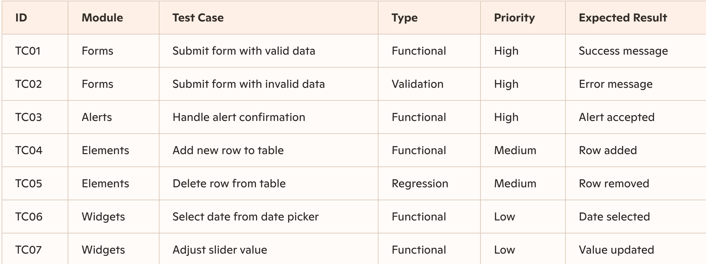

Test Plan – DemoQA automation portfolio
https://demoqa.com/

1. Introduction

This Test Plan defines the objectives, scope, approach, and resources for automating UI tests on the DemoQA site using Selenium + C#. It ensures consistency, maintainability, and professional QA practices aligned with portfolio goals.

2. Test Items

* Forms Module: Input fields, validation, submission.
* Elements Module: Tables, checkboxes, radio buttons.
* Alerts Module: Native browser alert handling.
* Widgets Module: Date picker and slider.

3. Features to be Tested

* Navigation across DemoQA modules.
* Form submission with valid and invalid data.
* Accepting a browser alert.
* Table interactions (add, edit, delete rows).
* Cross-browser compatibility (Chrome, Firefox, Edge).

3.1. Features Not to be Tested

* Authentication flows (DemoQA has no login).
* Security testing.

4. Test Case Prioritization

* High Priority: Smoke tests, form submission, alert handling.
* Medium Priority: Validation tests, table interactions.
* Low Priority: Exploratory widget interactions.

5. Test Environment

Local: Windows 10, .NET 8 SDK, Visual Studio/VS Code.

CI/CD: GitHub Actions pipeline with a Chrome, Firefox, and Edge browser matrix.

Data: Synthetic form inputs from the JSON test-data file.

Reporting: ExtentReports HTML report for local runs; TRX test results in CI.

6. Preconditions

* DemoQA site is accessible and stable.
* .NET 8 SDK installed.
* Selenium WebDriver dependencies restored; Selenium Manager resolves the browser driver.
* Synthetic test data is available in `src/Data/testData.json`.
* GitHub Actions runner configured with required dependencies.
* Reporting initialized by the test hooks.

7. Detailed Test Case Table

8. Schedule / Execution Plan

* Local Execution:
    - Smoke tests -> before each commit.
    - Functional + validation tests -> daily execution.

* CI/CD Execution (GitHub Actions):
    - Full UI suite and Chrome/Firefox/Edge matrix -> on pushes to `main`